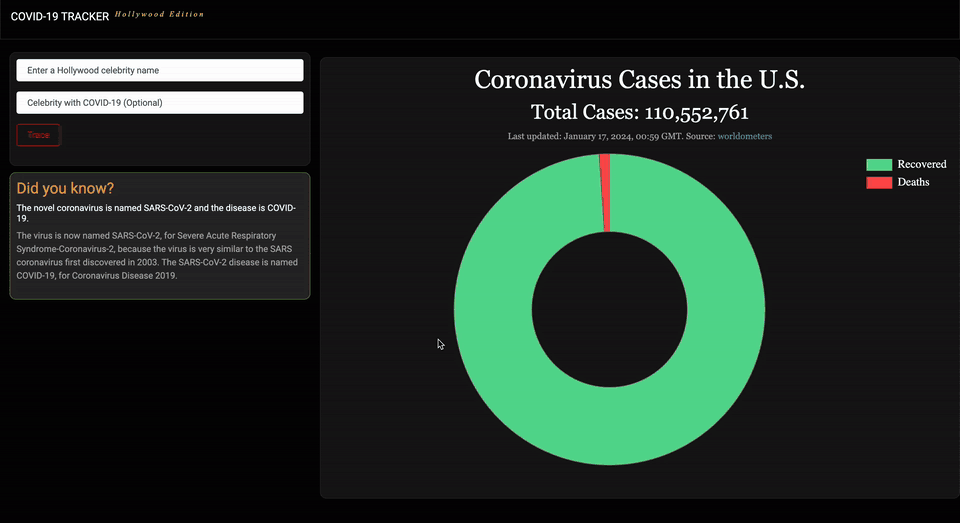

# COVID-19 Tracker: Hollywood Edition

Enter a Hollywood actor's name and the app traces the shortest chain of co-stars linking them to a celebrity who tested positive for COVID-19, then turns the number of steps into a playful "chance of contracting COVID-19". It's an AI search problem solved with breadth-first search over a database of about 1 million actors. The page also shows live U.S. COVID-19 case numbers and a random fact about the virus. Built with Python and Django.



▶️ **[Watch the full demo video](https://sangye-tenphel.s3.amazonaws.com/covid19Tracker.mp4)** (38 seconds)

## Features

- **Celebrity contact tracing:** type an actor and, optionally, a celebrity who had COVID-19 (Tom Hanks by default). The app shows the chain between them, for example *Johnny Depp met Christopher Walken in Nick of Time → Christopher Walken met Tom Hanks in Catch Me If You Can*.
- **"Chance of contracting" score:** 100% for a direct co-star, minus 10% for each extra step in the chain.
- **Handles ambiguous names:** if several actors share a name, it lists each one's IMDb id and birth year, and you enter the id instead. It also reports names it can't find and actors with no connection.
- **Live U.S. statistics:** total cases, deaths and recoveries are scraped from [Worldometer](https://www.worldometers.info/coronavirus/country/us/) with BeautifulSoup and shown in a Chart.js doughnut chart.
- **"Did you know?" facts:** a different COVID-19 fact on each page load.

## How it works

The search treats the problem like the classic "six degrees of Kevin Bacon":

- **States** are people, and **actions** are movies: two actors are connected if they starred in the same movie.
- The **initial state** is the actor you enter, and the **goal** is the celebrity with COVID-19.
- **Breadth-first search** (`lib/degrees.py`) explores co-stars level by level, so the first path it finds is the shortest.

The movie data comes from IMDb: about 1,044,500 people, 344,000 movies and 1.19 million actor–movie links, stored in `people.csv`, `movies.csv` and `stars.csv`. It's loaded into memory when the server starts.

## Project structure

The repository has three versions of the same Django app:

| Folder | Dataset | Notes |
|---|---|---|
| `covid_tracker_large/` | Full IMDb dataset (CSV) | The complete app |
| `covid_tracker_json/` | Full dataset, preconverted to JSON | Loads the data from JSON instead of parsing CSV; `dict to json/` holds the conversion script |
| `covid_tracker_small/` | A tiny sample (16 actors, 5 movies) | A lightweight version that was used for the online demo |

Inside each app (`covid_tracker_app/`):

```
lib/degrees.py   Data loading and the breadth-first search
scraper.py       Scrapes the U.S. statistics from Worldometer
facts.py         The random COVID-19 facts
views.py         Handles the search form and renders the page
templates/       The page layout (with the Chart.js chart)
db/              The IMDb data files
```

## Running it locally

The pinned package versions date from 2020, so use **Python 3.8**.

```bash
cd covid_tracker_large            # or covid_tracker_json/covid_tracker, or covid_tracker_small
python3.8 -m venv venv
source venv/bin/activate
pip install -r requirements.txt
python manage.py runserver
```

Then open http://127.0.0.1:8000. Loading the full dataset takes a little while on startup, and the server needs an internet connection, since it fetches the U.S. statistics from Worldometer when it starts.

## Built with

- **Backend:** Python, Django 3, BeautifulSoup4 and Requests (web scraping)
- **Frontend:** HTML, CSS, JavaScript and Chart.js
- **Data:** IMDb (actors, movies and credits) and Worldometer (COVID-19 statistics)

The online demo that used to run on Heroku is no longer available; the video above shows the app running locally.

Created by Sangye Tenphel, 2020.
